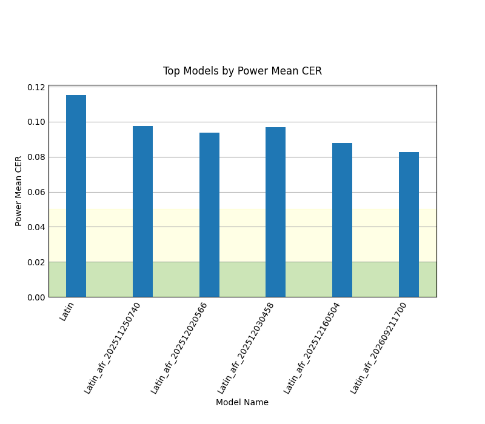
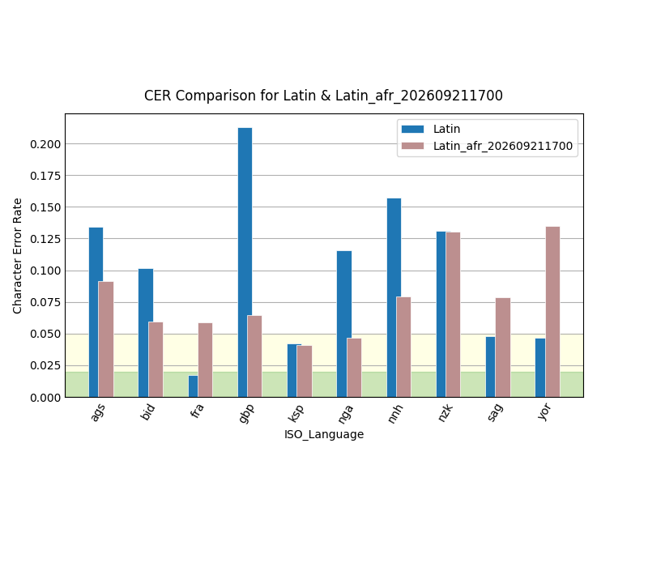

# Evaluation

Models are compared by their **power mean CER** (pmCER): the quadratic mean (p = 2) of the per-language CERs.
```
pmCER = sqrt(mean(CER_lang ** 2))
```
A perfect model has a pmCER of 0. Unlike a plain average, the power mean weighs the worst languages more heavily, so a model can't hide a poor result in one language behind good results in the others. It still improves whenever any single language improves. The best model is the one with the lowest pmCER.

### How the CER is calculated

1. **Page:** each test image is OCR'd (`--psm 4`) and compared with its ground truth by `jiwer`. In both texts, look-alike code points are first replaced with their standard form (`[properties.codepoint_map]` in [config.toml](data/Latin_afr/config.toml), e.g. Greek α → Latin ɑ), then the texts are NFD-normalized and blank lines are collapsed (paragraph breaks are layout, not content). CER = (S + D + I) / (S + D + H).
2. **Document:** pages are grouped by the part of the file name before `-p` (e.g. `aye-pg02.png` and `aye-pg03.png` belong to document `aye`). The document CER is calculated over the summed errors and characters of all its pages, so longer pages count more.
3. **Language:** the average of its documents' CERs.
4. **Model:** the pmCER of its language CERs. The plain average of the language CERs is also available (`-b cer`).

Each language counts equally, however many documents or pages it has.

### Test documents

The test set is in `data/representative-languages/<iso>_<name>/evaluation/` (an image and a `.gt.txt` file per page). These languages together cover the most common characters targeted by Latin_afr; see [Languages.md](data/representative-languages/Languages.md). Characters only covered by synthetic data are not evaluated.

ISO | Documents
:-: | :--
ags | primer
bid | Sida BID 2011
fra | french, pesticides
gbp | palu
ksp | rutu
nga | civic_1990
nnh | ano
nzk | guide
sag | aye
yor | iwe

### Results

As of 2026-10-12 (39 models evaluated), compared with the base `Latin` model:

Model | pmCER | average CER
:-- | :-: | :-:
Latin | 0.1153 | 0.0992
Latin_afr_202609211700 | 0.0826 | 0.0763
Latin_afr_202512160504 | 0.0879 | 0.0825





> - chart data gathered from [data/evaluation/data.csv](data/evaluation/data.csv)
> - OCR output saved in `data/evaluation/<iso>_<name>/<page>.<model>.txt`
> - evaluations performed by `jiwer` module in [scripts/evaluate-models.py](scripts/evaluate-models.py); summaries and charts by [scripts/show-chart.py](scripts/show-chart.py)

#### Earlier score (superseded)

Earlier models were rated by a score combining the average CER and its standard deviation, where 1000 was perfect (`Latin` scored 839):
```
score = 1000 / (0.75 * (1 + avg_cer) + 0.25 * (1 + std_dev)) ** 2
```
It was replaced by pmCER, which also favors models that do well across all languages, but without a separate standard-deviation term (which "dirty" test images inflate regardless of the model). The `score` property is kept in `show-chart.py` for reference, but it can no longer be chosen as a basis.

### Shortcomings

- i + grave accent commonly recognized as either i + macron-grave or dotless i + grave
- A single CER per model hides trade-offs, e.g. better non-ASCII recognition but more errors on plain ASCII text, or a regression in one language.

> 1. This testing has been done without any image preprocessing (e.g. increasing contrast to remove specks that could be confused for characters). It has also not made use of tesseract's character blacklist or whitelist features, which in some cases would significantly reduce substitution and/or insertion errors.

### Commands

```bash
(env) $ # OCR every test image with every model in tessdata/ (existing OCR output is reused) and rebuild data.csv.
(env) $ ./scripts/evaluate-models.py
Using model: Latin
 - Evaluating file: ...
 - Creating file: ...
  [...]
(env) $ # Create charts to summarize data (default basis: pmcer).
(env) $ ./scripts/show-chart.py                          # top models summary chart
(env) $ ./scripts/show-chart.py -t comp                  # Latin vs best model, by language
(env) $ ./scripts/show-chart.py -t comp -m MODEL1 MODEL2 # any two models, by language
(env) $ ./scripts/show-chart.py -t best                  # best model, by language
(env) $ ./scripts/show-chart.py -t model -m MODEL        # one model, by language
(env) $ ./scripts/show-chart.py -t language -l ISO       # every model, for one language
```

See [data/evaluation/README.md](data/evaluation/README.md) for the steps to add a new model.
